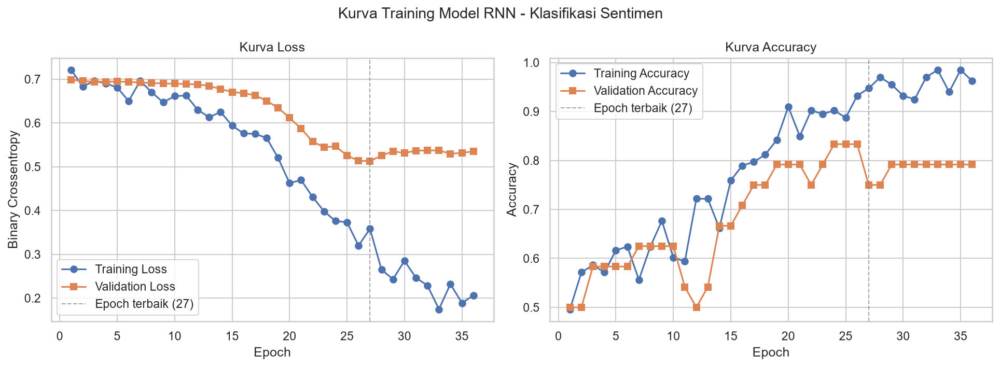
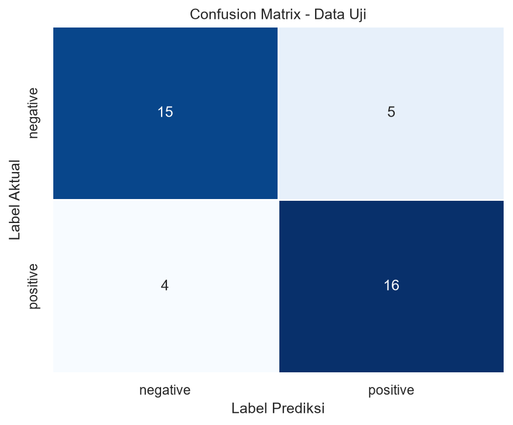
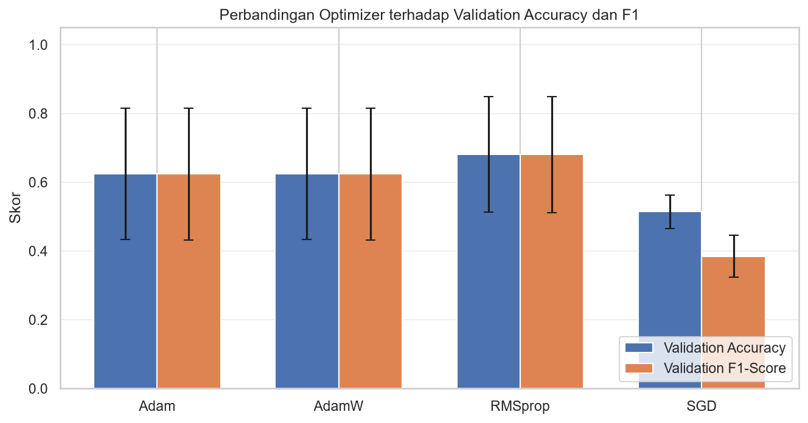
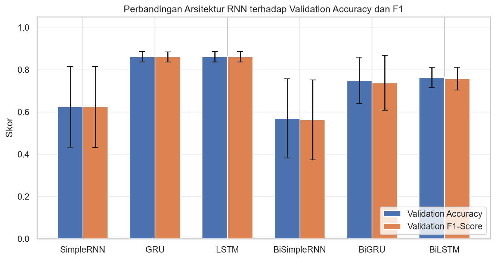
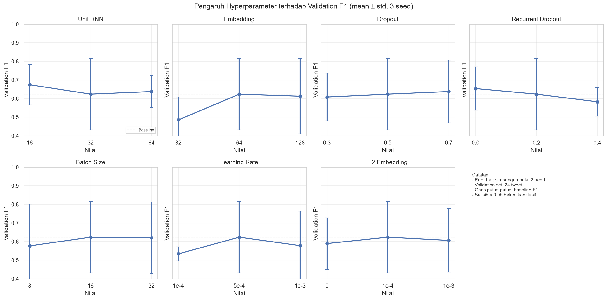
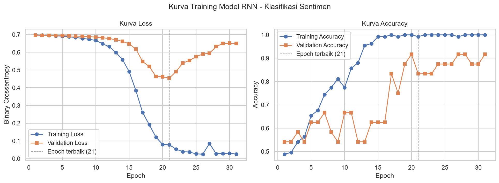
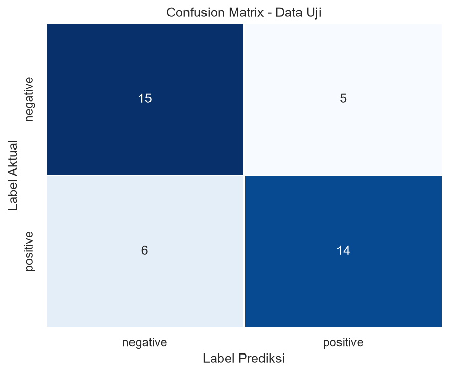

# Laporan Klasifikasi Sentimen Tweet Opini Film Menggunakan Recurrent Neural Network (RNN)

| Item | Keterangan |
|---|---|
| Dataset | `dataset_tweet_sentiment_opini_film.csv` |
| Skrip | `klasifikasi_sentimen_rnn.py`, `eksperimen_tuning.py` |
| Tugas | Klasifikasi teks many-to-one (satu tweet → satu label) |
| Model utama | SimpleRNN many-to-one |
| Model pembanding | GRU, LSTM, BiGRU, BiLSTM, dan BiSimpleRNN |
| Eksperimen tambahan | 23 konfigurasi × 3 seed (optimizer, arsitektur, hyperparameter) |
| Framework | TensorFlow 2.21.0 / Keras 3.15.1 |
| Bahasa data | Indonesia |

---

# 1. Deskripsi

## 1.1. Pendahuluan

Analisis sentimen merupakan salah satu tugas *natural language processing* (NLP) yang bertujuan menentukan kecenderungan opini dalam suatu teks, misalnya positif, negatif, atau netral. Pada media sosial, opini terhadap film ditulis secara singkat, informal, dan sering mengandung singkatan, mention, tagar, emoji, serta tanda baca yang tidak baku. Kondisi tersebut membuat proses preprocessing dan pemilihan model menjadi bagian penting dalam membangun sistem klasifikasi sentimen.

*Recurrent Neural Network* (RNN) merupakan arsitektur jaringan saraf yang dirancang untuk memproses data berurutan. Pada setiap langkah, RNN membaca satu token dan memperbarui *hidden state* yang menyimpan informasi dari token-token sebelumnya. Sifat ini membuat RNN sesuai untuk teks karena makna sebuah kata dapat bergantung pada konteks kata-kata di sekitarnya.

Eksperimen ini menggunakan skema **many-to-one**, yaitu seluruh urutan token dalam satu tweet diproses menjadi satu *hidden state* akhir, kemudian dipetakan menjadi satu label sentimen. Dengan demikian, satu tweet menghasilkan tepat satu prediksi: `negative` atau `positive`.

## 1.2. Tujuan

Tujuan dari eksperimen ini adalah:

1. Membaca dan memeriksa dataset sentimen tweet opini film dari file lokal.
2. Melakukan preprocessing teks dasar, meliputi *cleaning*, *case folding*, dan penghapusan karakter khusus.
3. Membagi dataset menjadi data latih dan data uji dengan proporsi yang terkontrol.
4. Membangun model RNN many-to-one menggunakan TensorFlow/Keras.
5. Melatih model dan menampilkan kurva *loss* serta *accuracy* selama proses training.
6. Mengevaluasi model pada data uji menggunakan *confusion matrix* dan *classification report* yang mencakup accuracy, precision, recall, dan F1-score.
7. Membandingkan optimizer, arsitektur RNN, dan beberapa hyperparameter melalui eksperimen tuning dengan beberapa random seed.
8. Menganalisis performa model, keterbatasan, dan peluang pengembangannya.

## 1.3. Dataset

Dataset yang digunakan adalah `dataset_tweet_sentiment_opini_film.csv` yang berada di folder yang sama dengan skrip. Dataset berisi opini berbahasa Indonesia mengenai film dan memiliki tiga kolom:

| Kolom | Tipe | Deskripsi |
|---|---|---|
| `Id` | Integer | Identitas unik setiap tweet |
| `Sentiment` | String | Label sentimen: `negative` atau `positive` |
| `Text Tweet` | String | Isi tweet opini film |

### Karakteristik data

| Statistik | Nilai |
|---|---:|
| Jumlah data mentah | 200 tweet |
| Jumlah kelas | 2 (biner) |
| Distribusi awal | 100 negative, 100 positive |
| Jumlah data setelah pembersihan duplikat | 197 tweet |
| Distribusi final | 99 negative, 98 positive |
| Panjang tweet | 2–26 kata |
| Rata-rata panjang tweet | 15.11 kata |
| Median panjang tweet | 16 kata |
| Rata-rata jumlah karakter | 97.9 karakter |

### Contoh data

| Id | Sentiment | Text Tweet |
|---:|---|---|
| 1 | negative | Jelek filmnya... apalagi si ernest gak mutu bgt actingnya... film sampah |
| 102 | positive | Habis nonton film Kong: Skull Island 2017. Lumayan greget filmnya, 7.5 deh.. layak buat nobar |
| 103 | positive | Bravo untuk #filmkartini! Pemainnya bagus, sudut pandang ceritanya pun menarik. Film yang penting untuk ditonton perempuan dan juga lelaki. |

Dataset bersifat seimbang sejak awal. Setelah teks dibersihkan, ditemukan tiga data duplikat sehingga jumlah data menjadi 197 dengan komposisi 99 tweet negatif dan 98 tweet positif. Keseimbangan ini membuat metrik accuracy dapat digunakan sebagai gambaran awal performa tanpa bias kelas yang ekstrem, meskipun precision, recall, dan F1-score tetap perlu dilaporkan.

Tantangan utama dataset adalah sifat teks media sosial yang tidak baku, misalnya penggunaan kata seperti `gak`, `bgt`, `yg`, `abis`, mention akun, tagar, dan emoji. Selain itu, jumlah data relatif kecil untuk melatih model *deep learning* dari awal.

---

# 2. Eksperimen

## 2.1. Lingkungan dan Alur Eksperimen

Eksperimen dijalankan menggunakan lingkungan berikut:

| Komponen | Versi |
|---|---|
| Python | 3.13.1 |
| TensorFlow | 2.21.0 |
| Keras | 3.15.1 |
| scikit-learn | 1.7.2 |
| pandas | 2.3.0 |
| NumPy | 2.2.2 |
| Matplotlib | 3.10.3 |
| Seaborn | 0.13.2 |
| Perangkat pelatihan | CPU |

Alur eksperimen secara ringkas:

```text
Dataset CSV
    ↓
Preprocessing teks (cleaning, case folding, hapus karakter khusus)
    ↓
Pembersihan data kosong dan duplikat
    ↓
Train-test split (stratified)
    ↓
Vektorisasi teks (TextVectorization, fit pada data latih)
    ↓
Embedding → SimpleRNN → Dense → Sigmoid
    ↓
Training + validasi
    ↓
Evaluasi pada data uji
    ↓
Kurva training, confusion matrix, classification report
```

Skrip dijalankan dengan perintah:

```bash
python klasifikasi_sentimen_rnn.py
```

## 2.2. Preprocessing Teks

Preprocessing dilakukan untuk mengurangi noise tanpa menghilangkan informasi sentimen utama. Tahapan yang diterapkan adalah:

1. **Cleaning**
   - Menghapus URL dan tautan `www`.
   - Menghapus mention seperti `@username`.
   - Menghapus penanda retweet `RT`.
   - Mengubah tagar `#kata` menjadi `kata` agar isi tagar tetap dipertahankan.
   - Mengubah HTML entity seperti `&amp;` menjadi karakter aslinya.
2. **Case folding**
   - Mengubah seluruh teks menjadi huruf kecil.
3. **Penghapusan karakter khusus**
   - Menghapus angka, tanda baca, emoji, simbol, dan karakter selain huruf `a–z` serta spasi.
4. **Normalisasi spasi**
   - Mengganti spasi berlebih menjadi satu spasi dan memangkas spasi di awal/akhir teks.
5. **Pembersihan data**
   - Membuang tweet yang menjadi kosong setelah preprocessing.
   - Membuang duplikat berdasarkan teks yang sudah dibersihkan.

Contoh hasil preprocessing:

```text
Sebelum : @beexkuanlin Sepanjang film gwa berkata kasar terus pada bapaknya
Sesudah : sepanjang film gwa berkata kasar terus pada bapaknya

Sebelum : Banyak yg kecewa abis nonton film ini :(
Sesudah : banyak yg kecewa abis nonton film ini
```

Preprocessing ini sengaja dibatasi pada tahap dasar. Stemming, penghapusan stopword, normalisasi kata gaul, dan penanganan negasi tidak diterapkan agar eksperimen tetap sesuai dengan ketentuan preprocessing dasar. Konsekuensinya, variasi kata seperti `gak` dan `tidak` tetap dianggap sebagai token yang berbeda.

## 2.3. Pembagian Data

Dataset dibagi menggunakan `train_test_split` dari scikit-learn dengan `random_state=42` dan stratifikasi berdasarkan label. Stratifikasi memastikan proporsi kelas negatif dan positif tetap seimbang pada setiap subset.

| Subset | Negative | Positive | Total | Proporsi dari 197 |
|---|---:|---:|---:|---:|
| Data latih | 67 | 66 | 133 | 67.5% |
| Data validasi | 12 | 12 | 24 | 12.2% |
| Data uji | 20 | 20 | 40 | 20.3% |
| **Total** | **99** | **98** | **197** | **100%** |

Data validasi diambil dari sebagian data latih, bukan dari data uji. Proporsi data uji adalah 20% dari total data, sedangkan data validasi adalah 15% dari 157 data latih (sebelum pemisahan validasi), sehingga diperoleh 24 tweet validasi. Dengan demikian, data uji tetap murni dan hanya digunakan satu kali pada evaluasi akhir. Data validasi dimanfaatkan untuk memantau performa selama training dan menentukan kapan proses training dihentikan.

## 2.4. Vektorisasi Teks

Teks yang sudah dibersihkan diubah menjadi urutan bilangan bulat menggunakan layer `TextVectorization` dari Keras dengan konfigurasi:

| Parameter | Nilai |
|---|---:|
| Strategi pemisahan token | Whitespace |
| Panjang sequence | 23 token |
| Ukuran kosakata hasil adapt | 845 token |
| Batas maksimum kosakata | 10,000 |
| Padding | 0 |
| Token di luar kosakata | `[UNK]` |

Panjang sequence 23 ditentukan dari persentil ke-95 jumlah kata pada data latih. Nilai tersebut kemudian dibatasi pada rentang 10–60 token. Layer vektorisasi hanya di-*adapt* pada data latih untuk mencegah *data leakage* dari data validasi maupun data uji.

Bentuk data setelah vektorisasi:

- Data latih: `(133, 23)`
- Data validasi: `(24, 23)`
- Data uji: `(40, 23)`

## 2.5. Arsitektur Model

Model yang digunakan adalah RNN many-to-one dengan detail sebagai berikut:

| Layer | Output Shape | Jumlah Parameter | Keterangan |
|---|---:|---:|---|
| Input `token_ids` | `(None, 23)` | 0 | Sequence token integer |
| `Embedding` | `(None, 23, 64)` | 54,080 | Dimensi embedding 64, regularisasi L2 |
| `SimpleRNN` | `(None, 32)` | 3,104 | 32 unit, `return_sequences=False` |
| `Dense` | `(None, 32)` | 1,056 | Aktivasi ReLU |
| `Dropout` | `(None, 32)` | 0 | Dropout 0.5 |
| `Dense` output | `(None, 1)` | 33 | Aktivasi Sigmoid |
| **Total parameter trainable** |  | **58,273** |  |

Karena layer SimpleRNN menggunakan `return_sequences=False`, model hanya mengambil *hidden state* terakhir dari seluruh urutan. Inilah yang membuat arsitektur tersebut termasuk **many-to-one**: banyak token masukan menghasilkan satu keluaran.

Beberapa teknik regularisasi digunakan karena dataset hanya berisi 197 tweet:

- Dropout sebesar 0.5 pada input RNN.
- Recurrent dropout sebesar 0.2 pada koneksi rekuren.
- Dropout sebesar 0.5 pada layer dense.
- Regularisasi L2 sebesar `1e-4` pada matriks embedding.

Model dikompilasi dengan:

| Komponen | Nilai |
|---|---|
| Optimizer | Adam |
| Learning rate awal | 0.0005 |
| Fungsi loss | Binary crossentropy |
| Metrik | Accuracy |
| Label | `negative = 0`, `positive = 1` |
| Ambang prediksi | 0.5 |

## 2.6. Konfigurasi Pelatihan

| Parameter | Nilai |
|---|---:|
| Random seed | 42 |
| Maksimum epoch | 60 |
| Batch size | 16 |
| Early stopping | Monitor `val_loss`, patience 10, `min_delta=1e-4` |
| Restore best weights | Ya |
| ReduceLROnPlateau | Factor 0.5, patience 4, minimum learning rate `1e-5` |
| Model checkpoint | Monitor `val_loss`, simpan model terbaik |

Selama training, performa data latih dan data validasi dicatat. Setelah training selesai, bobot model dikembalikan ke epoch dengan `val_loss` terbaik. Model terbaik juga disimpan sebagai `output_rnn/model_rnn_terbaik.keras`.

Training berhenti pada epoch ke-36 setelah `val_loss` tidak lagi membaik sesuai patience 10. Nilai `val_loss` terbaik adalah **0.5132** pada epoch ke-27.

## 2.7. Metrik Evaluasi

Evaluasi dilakukan pada 40 data uji yang tidak pernah digunakan selama training maupun pemilihan model. Probabilitas keluaran sigmoid diubah menjadi kelas dengan ambang 0.5:

```text
probabilitas >= 0.5  → positive
probabilitas < 0.5   → negative
```

Metrik yang digunakan:

```text
Accuracy  = (TP + TN) / (TP + TN + FP + FN)
Precision = TP / (TP + FP)
Recall    = TP / (TP + FN)
F1-Score  = 2 × (Precision × Recall) / (Precision + Recall)
```

Karena data uji seimbang, nilai *weighted average* dan *macro average* untuk precision, recall, dan F1-score identik. Laporan tetap menampilkan metrik per kelas agar perilaku model terhadap masing-masing sentimen dapat dianalisis.

## 2.8. Eksperimen Pembanding dan Tuning Hyperparameter

Untuk memperkuat analisis dan membandingkan beberapa pilihan desain model, dilakukan eksperimen tambahan yang diimplementasikan pada `eksperimen_tuning.py`. Eksperimen ini menggunakan split data, vektorisasi, dan protokol evaluasi yang sama dengan eksperimen utama agar hasilnya dapat dibandingkan secara adil.

Strategi eksperimen:

- Data latih, validasi, dan uji tetap 133, 24, dan 40 tweet.
- Setiap konfigurasi dijalankan dengan **tiga random seed**, yaitu 42, 123, dan 2024, sehingga diperoleh rata-rata dan simpangan baku performa validasi.
- Seluruh konfigurasi menggunakan early stopping, ReduceLROnPlateau, dan hyperparameter baseline yang sama; hanya faktor yang sedang diuji yang diubah.
- Pemilihan konfigurasi terbaik dilakukan berdasarkan **rata-rata validation F1-score** dari tiga seed, dengan validation accuracy dan validation loss sebagai *tie-breaker*.
- Data uji tidak digunakan untuk memilih konfigurasi. Data uji hanya dipakai sekali untuk mengevaluasi konfigurasi terbaik pada akhir eksperimen.
- Terdapat **23 konfigurasi unik** dan **69 run training** (23 konfigurasi × 3 seed).

Faktor yang diuji:

| Kelompok | Nilai yang diuji | Nilai baseline |
|---|---|---|
| Optimizer | Adam, AdamW, RMSprop, SGD | Adam, learning rate 5e-4 |
| Arsitektur RNN | SimpleRNN, GRU, LSTM, BiSimpleRNN, BiGRU, BiLSTM | SimpleRNN 32 unit |
| Jumlah unit RNN | 16, 32, 64 | 32 |
| Dimensi embedding | 32, 64, 128 | 64 |
| Dropout RNN | 0.3, 0.5, 0.7 | 0.5 |
| Recurrent dropout | 0.0, 0.2, 0.4 | 0.2 |
| Batch size | 8, 16, 32 | 16 |
| Learning rate | 1e-4, 5e-4, 1e-3 | 5e-4 |
| Regularisasi L2 embedding | 0, 1e-4, 1e-3 | 1e-4 |

Pada perbandingan optimizer, learning rate disesuaikan dengan karakter masing-masing optimizer agar perbandingan tidak bias: Adam dan AdamW menggunakan 5e-4, RMSprop 1e-3, serta SGD 5e-3 dengan momentum 0.9 dan Nesterov. AdamW menggunakan weight decay 1e-4. Pengaturan ini dipertahankan sama untuk seluruh seed pada optimizer yang bersangkutan.

Seluruh hasil per run, ringkasan statistik, dan grafik perbandingan disimpan di folder `output_rnn/tuning/`. Hasil yang sudah dipecah per kelompok eksperimen (karena baseline muncul di beberapa kelompok) disimpan di `output_rnn/tuning/hasil_tuning_per_grup.csv`.


---

# 3. Analisis

## 3.1. Kurva Loss dan Accuracy



*Gambar 1. Kurva training dan validasi model SimpleRNN.*

Beberapa pola penting dari kurva training:

- **Loss data latih** menurun dari 0.7211 pada epoch pertama menjadi 0.2061 pada epoch terakhir. **Accuracy data latih** meningkat dari 49.62% menjadi 96.24%.
- **Loss validasi** menurun dari 0.6986 menjadi 0.5350, dengan nilai minimum 0.5132 pada epoch ke-27. **Accuracy validasi** sempat mencapai 83.33% pada epoch 24–26, lalu berfluktuasi dan berada di 79.17% pada epoch terakhir.
- Jarak antara performa data latih dan validasi semakin lebar setelah pertengahan training. Data latih mendekati 100%, sedangkan validasi tertahan di kisaran 75%–83%. Pola ini menunjukkan **overfitting**, yaitu model mulai menghafal data latih dan kurang mampu melakukan generalisasi.
- Regularisasi berupa dropout, recurrent dropout, dan L2 memperlambat overfitting. Early stopping kemudian memilih model dengan `val_loss` terbaik, bukan model pada epoch terakhir yang sudah terlalu menyesuaikan diri dengan data latih.

Pemilihan model berdasarkan `val_loss` menghasilkan model pada epoch ke-27. Pada epoch tersebut, accuracy data latih adalah 94.74% dan accuracy validasi 75.00%. Walaupun accuracy validasi bukan yang tertinggi, `val_loss` yang minimum menunjukkan model tersebut memberikan probabilitas prediksi yang relatif lebih terkalibrasi dibandingkan epoch-epoch setelahnya.

## 3.2. Confusion Matrix



*Gambar 2. Confusion matrix model pada 40 data uji.*

| Aktual \ Prediksi | Negative | Positive | Total |
|---|---:|---:|---:|
| **Negative** | 15 (TN) | 5 (FP) | 20 |
| **Positive** | 4 (FN) | 16 (TP) | 20 |
| **Total** | 19 | 21 | 40 |

Keterangan:

- **TN (True Negative)** = 15: tweet negatif yang benar diprediksi negatif.
- **FP (False Positive)** = 5: tweet negatif yang salah diprediksi positif.
- **FN (False Negative)** = 4: tweet positif yang salah diprediksi negatif.
- **TP (True Positive)** = 16: tweet positif yang benar diprediksi positif.

Model membuat 9 kesalahan dari 40 data uji, terdiri atas 5 false positive dan 4 false negative. Distribusi kesalahan cukup seimbang, sehingga model tidak condong secara ekstrem ke salah satu kelas. Prediksi positif sedikit lebih banyak (21) dibandingkan prediksi negatif (19), tetapi selisihnya kecil.

## 3.3. Hasil Metrik Evaluasi

### Metrik keseluruhan

| Metrik | Nilai |
|---|---:|
| Accuracy | **0.7750 (77.50%)** |
| Precision (weighted) | **0.7757** |
| Recall (weighted) | **0.7750** |
| F1-score (weighted) | **0.7749** |
| Precision (macro) | 0.7757 |
| Recall (macro) | 0.7750 |
| F1-score (macro) | 0.7749 |

### Metrik per kelas

| Kelas | Precision | Recall | F1-score | Support |
|---|---:|---:|---:|---:|
| negative | 0.7895 | 0.7500 | 0.7692 | 20 |
| positive | 0.7619 | 0.8000 | 0.7805 | 20 |
| **Macro average** | **0.7757** | **0.7750** | **0.7749** | **40** |
| **Weighted average** | **0.7757** | **0.7750** | **0.7749** | **40** |

### Pembacaan hasil

- **Accuracy 77.50%** berarti model benar memprediksi 31 dari 40 tweet.
- Karena data uji seimbang 20 negatif dan 20 positif, baseline model yang selalu menebak satu kelas adalah 50%. Model meningkatkan accuracy sebesar **27.5 poin persentase** di atas baseline tersebut.
- **Precision negatif** (0.7895) lebih tinggi daripada precision positif (0.7619). Artinya, ketika model memprediksi negatif, peluang prediksi tersebut benar sedikit lebih besar.
- **Recall positif** (0.8000) lebih tinggi daripada recall negatif (0.7500). Model lebih berhasil menemukan tweet positif daripada tweet negatif.
- **F1-score** kedua kelas relatif seimbang, yaitu 0.7692 untuk negatif dan 0.7805 untuk positif. Tidak ada kelas yang tertinggal secara ekstrem.

Dengan hanya 40 data uji, satu kesalahan mengubah accuracy sebesar 2.5 poin persentase. Interval kepercayaan 95% untuk accuracy (metode Clopper–Pearson) berada di kisaran **61.6%–89.2%**. Rentang yang lebar ini menunjukkan bahwa hasil evaluasi perlu dipandang sebagai estimasi, bukan angka performa yang pasti.

## 3.4. Hasil Eksperimen Pembanding dan Tuning Hyperparameter

Sebanyak 23 konfigurasi unik diuji dengan tiga random seed, sehingga totalnya 69 run training. Semua konfigurasi menggunakan split data dan vektorisasi yang sama. Pemilihan konfigurasi dilakukan berdasarkan rata-rata validation F1-score; data uji baru digunakan pada evaluasi akhir konfigurasi terbaik. Tabel lengkap tersedia di `output_rnn/tuning/ringkasan_tuning.csv`, sedangkan hasil per run ada di `output_rnn/tuning/hasil_tuning_per_seed.csv`.

Sebagai pembanding awal, konfigurasi baseline SimpleRNN 32 unit memperoleh validation accuracy **0.6250 ± 0.1909**, validation F1-score **0.6237 ± 0.1917**, dan validation loss **0.6358 ± 0.1063** dari tiga seed. Variasi antar seed yang sangat lebar menunjukkan bahwa SimpleRNN cukup sensitif terhadap inisialisasi pada dataset kecil ini.

### 3.4.1. Perbandingan optimizer



*Gambar 3. Validation accuracy dan F1-score untuk empat optimizer.*

| Optimizer | Validation Accuracy | Validation F1-score | Validation Loss | Rata-rata waktu training (detik) |
|---|---:|---:|---:|---:|
| Adam | 0.6250 ± 0.1909 | 0.6237 ± 0.1917 | 0.6358 ± 0.1063 | 3.7 |
| AdamW | 0.6250 ± 0.1909 | 0.6237 ± 0.1917 | 0.6358 ± 0.1063 | 3.7 |
| RMSprop | **0.6806 ± 0.1684** | **0.6804 ± 0.1684** | **0.6016 ± 0.0855** | 5.1 |
| SGD | 0.5139 ± 0.0481 | 0.3846 ± 0.0609 | 0.6899 ± 0.0071 | 3.0 |

RMSprop memiliki rata-rata validation F1-score tertinggi, tetapi simpangan bakunya juga besar (0.1684). Selisih rata-rata terhadap Adam hanya sekitar 0.057 dan masih jauh lebih kecil daripada variasi antar seed, sehingga belum cukup bukti bahwa RMSprop secara konsisten lebih baik. Adam dan AdamW menghasilkan nilai yang identik pada presisi empat desimal karena weight decay AdamW yang digunakan cukup kecil (1e-4) dan early stopping berhenti pada titik yang sama.

SGD dengan learning rate 5e-3 dan momentum 0.9 justru tertinggal jauh. Validation F1-score-nya hanya 0.3846 dan loss-nya paling tinggi, yang mengindikasikan model belum cukup terlatih dalam batas 60 epoch. Hasil ini menunjukkan bahwa pemilihan optimizer perlu disertai penyesuaian learning rate dan jumlah epoch; perbandingan optimizer tanpa kontrol tersebut tidak dapat disimpulkan secara sederhana.

### 3.4.2. Perbandingan arsitektur RNN



*Gambar 4. Validation accuracy dan F1-score untuk enam varian arsitektur RNN.*

| Arsitektur | Validation Accuracy | Validation F1-score | Validation Loss | Rata-rata waktu training (detik) |
|---|---:|---:|---:|---:|
| SimpleRNN | 0.6250 ± 0.1909 | 0.6237 ± 0.1917 | 0.6358 ± 0.1063 | 3.7 |
| **GRU** | **0.8611 ± 0.0241** | **0.8610 ± 0.0239** | **0.4584 ± 0.0055** | 5.8 |
| LSTM | **0.8611 ± 0.0241** | 0.8606 ± 0.0246 | 0.5485 ± 0.0279 | 5.3 |
| BiSimpleRNN | 0.5694 ± 0.1879 | 0.5628 ± 0.1895 | 0.6928 ± 0.0193 | 5.3 |
| BiGRU | 0.7500 ± 0.1102 | 0.7383 ± 0.1300 | 0.5288 ± 0.0529 | 9.2 |
| BiLSTM | 0.7639 ± 0.0481 | 0.7573 ± 0.0538 | 0.6379 ± 0.0204 | 9.2 |

Perbedaan paling jelas datang dari **jenis arsitektur**, bukan dari optimizer atau hyperparameter lain. GRU dan LSTM sama-sama mencapai rata-rata validation accuracy 0.8611 dan F1-score sekitar 0.861, jauh di atas SimpleRNN (0.6237). Yang lebih penting, simpangan bakunya mengecil drastis: dari 0.1917 pada SimpleRNN menjadi sekitar 0.024 pada GRU/LSTM. Artinya, GRU dan LSTM tidak hanya lebih akurat secara rata-rata, tetapi juga jauh lebih stabil pada tiga seed yang diuji.

GRU sedikit lebih unggul dari LSTM pada validation loss (0.4584 vs 0.5485), sedangkan waktu training keduanya sebanding (5.8 vs 5.3 detik; selisih kecil pada data sekecil ini). Struktur gating pada GRU/LSTM membantu model mengatur informasi mana yang perlu dipertahankan, sehingga lebih tahan terhadap *vanishing gradient* dibandingkan SimpleRNN.

Sebaliknya, varian bidirectional tidak memberikan peningkatan. BiGRU dan BiLSTM berada di bawah versi satu arahnya, sedangkan BiSimpleRNN justru paling rendah. Dengan hanya 133 data latih dan tweet yang relatif pendek (23 token), menambah arah pemrosesan berarti menambah parameter dan risiko overfitting tanpa cukup data untuk memanfaatkannya. Waktu training varian bidirectional juga sekitar 1,6–1,7 kali lipat dibanding versi satu arah.

### 3.4.3. Tuning hyperparameter



*Gambar 5. Pengaruh tiap hyperparameter terhadap validation F1-score (mean ± std, 3 seed). Garis putus-putus adalah baseline.*

| Kelompok | Nilai terbaik | Validation F1-score | Selisih terhadap baseline |
|---|---|---:|---:|
| Jumlah unit RNN | 16 | 0.6747 | +0.0510 |
| Dimensi embedding | 64 | 0.6237 | 0.0000 |
| Dropout RNN | 0.7 | 0.6377 | +0.0140 |
| Recurrent dropout | 0.0 | 0.6539 | +0.0302 |
| Batch size | 16 | 0.6237 | 0.0000 |
| Learning rate | 5e-4 | 0.6237 | 0.0000 |
| L2 embedding | 1e-4 | 0.6237 | 0.0000 |

Tabel di atas berasal dari tuning satu faktor pada satu waktu dengan arsitektur SimpleRNN. Nilai “terbaik” pada tiap baris belum tentu tetap terbaik jika digabungkan, sehingga konfigurasi terbaik keseluruhan tetap ditentukan dari 23 konfigurasi yang diuji, bukan dari menggabungkan nilai terbaik per faktor secara langsung. Konfigurasi terbaik keseluruhan ternyata adalah GRU 32 unit, bukan SimpleRNN dengan unit 16.

Tidak ada satu pun perubahan hyperparameter yang menghasilkan peningkatan besar dan konsisten. Selisih terbesar hanya sekitar 0.051 (unit 16 vs 32), sementara simpangan baku antar seed pada kelompok yang sama berkisar 0.08–0.22. Dengan kata lain, perbedaan tersebut **berada di dalam noise** dan belum dapat dianggap sebagai peningkatan yang nyata.

Beberapa pola yang tetap dapat dibaca:

- **Unit 16** sedikit lebih baik daripada 32 dan 64. Model yang lebih kecil lebih sesuai untuk 133 data latih; unit 64 tidak memberikan peningkatan yang berarti dibandingkan unit 32.
- **Embedding 32** paling buruk (F1 0.4853), sedangkan 64 dan 128 hampir setara. Representasi 32 dimensi terlalu sempit untuk 845 token, tetapi memperbesar ke 128 tidak lagi memberi manfaat.
- **Dropout 0.7** sedikit lebih tinggi dari 0.5 dan 0.3, tetapi perbedaannya kecil. Recurrent dropout 0.0 justru sedikit lebih baik dari 0.2 dan 0.4; regularisasi rekuren yang terlalu kuat dapat mengganggu pembelajaran pada sequence pendek.
- **Batch size 8** lebih buruk daripada 16/32. Batch 16 dan 32 hampir identik; batch 16 dipilih karena memberi update lebih sering tanpa terlalu banyak noise.
- **Learning rate 1e-4** membuat model underfit (F1 0.5341), sedangkan 1e-3 tidak lebih baik dari 5e-4. Learning rate 5e-4 adalah titik yang paling seimbang.
- **L2 1e-3** sedikit lebih rendah daripada 1e-4, tetapi masih lebih tinggi daripada tanpa L2 (0). Regularisasi L2 yang terlalu kuat tidak diperlukan karena dropout sudah cukup menahan overfitting.

### 3.4.4. Konfigurasi terbaik dan evaluasi data uji

Konfigurasi dengan rata-rata validation F1-score tertinggi adalah **GRU 32 unit** dengan hyperparameter baseline lainnya:

| Parameter | Nilai |
|---|---|
| Arsitektur | GRU, satu arah |
| Jumlah unit | 32 |
| Dimensi embedding | 64 |
| Dropout RNN | 0.5 |
| Recurrent dropout | 0.2 |
| Dense hidden | 32 |
| Dropout dense | 0.5 |
| L2 embedding | 1e-4 |
| Learning rate | 5e-4 |
| Batch size | 16 |
| Optimizer | Adam |
| Jumlah parameter | 64,577 |

Konfigurasi ini memperoleh validation accuracy **0.8611 ± 0.0241**, validation F1-score **0.8610 ± 0.0239**, dan validation loss **0.4584 ± 0.0055**. Model kemudian dilatih ulang pada data latih dengan seed 42 dan dievaluasi pada 40 data uji.



*Gambar 6. Kurva training konfigurasi GRU terbaik. Early stopping memilih epoch ke-21.*



*Gambar 7. Confusion matrix konfigurasi GRU terbaik pada data uji.*

| Aktual \ Prediksi | Negative | Positive | Total |
|---|---:|---:|---:|
| **Negative** | 15 (TN) | 5 (FP) | 20 |
| **Positive** | 6 (FN) | 14 (TP) | 20 |
| **Total** | 21 | 19 | 40 |

| Model | Accuracy | Precision (weighted) | Recall (weighted) | F1-score (weighted) |
|---|---:|---:|---:|---:|
| Baseline SimpleRNN | **0.7750** | **0.7757** | **0.7750** | **0.7749** |
| Tuning terbaik (GRU) | 0.7250 | 0.7256 | 0.7250 | 0.7248 |

Tabel perbandingan ini juga tersimpan di `output_rnn/tuning/model_terbaik/perbandingan_baseline_vs_terbaik.csv`.

Hasil data uji konfigurasi GRU adalah **72.50%** (29 dari 40 benar), dengan 15 true negative, 5 false positive, 6 false negative, dan 14 true positive. Angka ini **lebih rendah 5 poin persentase** daripada baseline SimpleRNN (77.50%). Perbedaannya setara dengan dua tweet saja. Interval kepercayaan 95% accuracy GRU adalah sekitar **56.1%–85.4%**, sedangkan baseline **61.6%–89.2%**; kedua interval saling tumpang tindih lebar. Oleh karena itu, perbedaan 72.50% vs 77.50% **belum dapat dianggap sebagai perbedaan yang signifikan** pada data uji sekecil ini.

Kurva training GRU juga menunjukkan overfitting: training accuracy mencapai 100%, sedangkan validation accuracy tertahan di sekitar 83%. Early stopping memilih epoch ke-21 dengan validation loss terbaik. Pola ini konsisten dengan keterbatasan data, bukan berarti GRU lebih buruk secara struktural.

### 3.4.5. Ringkasan temuan tuning

1. **Arsitektur adalah faktor yang paling berpengaruh.** GRU/LSTM meningkatkan rata-rata validation F1 dari 0.6237 menjadi sekitar 0.861 dan menurunkan simpangan baku antar seed dari 0.192 menjadi 0.024.
2. **Bidirectional tidak membantu pada dataset ini.** BiGRU/BiLSTM lebih rendah dari versi satu arah dan membutuhkan waktu training hampir dua kali lipat.
3. **Perubahan hyperparameter tunggal tidak konklusif.** Semua selisih berada dalam rentang noise validation set yang hanya 24 sampel; tuning satu faktor pada satu waktu belum cukup untuk menemukan kombinasi optimal.
4. **RMSprop sedikit lebih tinggi secara rata-rata, tetapi variansnya besar.** Adam/AdamW tetap pilihan yang aman; SGD underfit pada konfigurasi yang diuji.
5. **GRU lebih stabil pada validasi, tetapi belum mengungguli baseline pada data uji.** Baseline 77.50% vs GRU 72.50% hanya berbeda dua tweet dan interval kepercayaannya tumpang tindih. Diperlukan k-fold cross-validation atau data yang lebih banyak sebelum menyimpulkan pemenang secara definitif.

## 3.5. Pembahasan

### Hal yang sudah bekerja dengan baik

1. **Alur eksperimen valid.** Data uji dipisahkan sejak awal, vektorisasi hanya di-*adapt* pada data latih, dan data validasi berasal dari data latih. Eksperimen tuning juga memakai split yang sama dan memilih konfigurasi hanya berdasarkan validation set; data uji tidak digunakan untuk memilih model.
2. **Model mampu mempelajari sinyal sentimen.** Accuracy model utama 77.50% jauh di atas baseline 50%, menunjukkan bahwa model menangkap kata-kata yang berkaitan dengan opini, seperti `bagus`, `keren`, `jelek`, `kecewa`, dan `membosankan`.
3. **Preprocessing dasar cukup efektif.** Penghapusan mention, URL, dan karakter khusus mengurangi noise tanpa menghilangkan kata utama yang membawa sentimen.
4. **Regularisasi dan early stopping membantu.** Tanpa regularisasi, SimpleRNN dengan dataset sekecil ini sangat cepat overfit. Dengan dropout, recurrent dropout, L2, dan pemilihan bobot terbaik, model masih menghasilkan performa yang wajar pada data uji.
5. **Tuning memberikan informasi desain yang berguna.** GRU/LSTM secara konsisten lebih baik daripada SimpleRNN pada validation set, dengan rata-rata F1 sekitar 0.861 dan simpangan baku yang jauh lebih kecil. Temuan ini lebih informatif daripada perbedaan kecil antarseed pada model baseline.

### Sumber kesalahan dan keterbatasan

1. **Overfitting akibat data terbatas.** Data latih hanya 133 tweet. Training accuracy model utama mencapai 96.24%, sedangkan pada GRU tuning bahkan mencapai 100%; validation accuracy tertahan di kisaran 75%–83%. Model memiliki kapasitas yang cukup untuk menghafal pola data latih.
2. **Keterbatasan SimpleRNN.** SimpleRNN lebih rentan terhadap *vanishing gradient* dibandingkan LSTM atau GRU. Tuning mengonfirmasi hal ini: rata-rata validation F1 SimpleRNN hanya 0.6237 dengan simpangan baku 0.1917, sedangkan GRU mencapai 0.8610 dengan simpangan baku 0.0239.
3. **Preprocessing masih dasar.** Tidak ada stemming, normalisasi kata gaul, penghapusan stopword, atau penanganan negasi. Kata seperti `gak`, `tidak`, dan `nggak` dapat menjadi token terpisah; kata seperti `bgt` dan `yg` juga tidak dinormalisasi. Hal ini memperbesar kosakata dan mempersulit generalisasi.
4. **Kehilangan sebagian informasi.** Penghapusan angka, tanda baca, dan emoji menghilangkan isyarat sentimen tertentu. Contohnya, emoji sedih atau tanda seru dapat memperkuat opini negatif, tetapi tidak lagi tersedia untuk model.
5. **Sarkasme dan sentimen campuran.** Tweet seperti pujian yang disertai kritik, atau kalimat sarkastik, sulit diklasifikasikan oleh model berbasis embedding kata yang dilatih dari data kecil.
6. **Evaluasi bergantung pada satu split.** Hasil 77.50% berasal dari satu pembagian data dengan `random_state=42`. Tiga random seed pada eksperimen tuning hanya mengukur variasi inisialisasi dan urutan training, bukan variasi pembagian data. Pembagian lain dapat menghasilkan angka yang berbeda cukup besar karena ukuran data uji hanya 40.
7. **Validation set terlalu kecil untuk tuning yang rinci.** Hanya ada 24 data validasi, sehingga satu prediksi yang berubah setara 4.17 poin persentase. Perbedaan hyperparameter di bawah sekitar 0.05 F1 pada eksperimen ini belum dapat dipercaya sebagai peningkatan yang nyata.

### Saran pengembangan

1. **Melanjutkan perbandingan arsitektur dengan protokol yang lebih kuat.** Hasil tuning sudah menunjukkan GRU/LSTM lebih baik pada validation set; langkah berikutnya adalah menguji kandidat tersebut dengan k-fold cross-validation atau nested cross-validation dan data yang lebih banyak.
2. Menerapkan **k-fold cross-validation** dan beberapa random seed agar estimasi performa lebih stabil, bukan hanya dari satu split 133/24/40.
3. Menambahkan **normalisasi kata gaul**, **stemming Sastrawi**, dan **penanganan negasi** untuk memperkecil variasi kosakata.
4. Menggunakan **pretrained word embedding bahasa Indonesia** (misalnya fastText atau Word2Vec) agar kata yang jarang muncul tetap memiliki representasi yang bermakna.
5. Menambah jumlah data atau melakukan augmentasi data untuk mengurangi overfitting.
6. Melakukan **tuning yang lebih luas** (grid search, random search, atau Bayesian optimization) dengan validasi silang, karena tuning satu faktor pada satu waktu belum cukup untuk menemukan kombinasi optimal.
7. Menganalisis kesalahan per tweet untuk memahami pola sarkasme dan sentimen campuran, lalu menyesuaikan preprocessing atau model.

---

# 4. Kesimpulan

Eksperimen klasifikasi sentimen tweet opini film menggunakan **SimpleRNN many-to-one** telah berhasil diimplementasikan dengan TensorFlow/Keras. Dataset lokal berisi 200 tweet, yang setelah pembersihan duplikat menjadi 197 tweet dengan komposisi 99 negatif dan 98 positif. Data dibagi secara stratified menjadi 133 data latih, 24 data validasi, dan 40 data uji.

Model menerima sequence token hasil `TextVectorization` dengan panjang 23 token dan kosakata 845 kata, kemudian memprosesnya melalui embedding, SimpleRNN 32 unit, layer dense, dropout, dan output sigmoid. Regularisasi L2, dropout, recurrent dropout, ReduceLROnPlateau, serta early stopping digunakan untuk mengendalikan overfitting pada dataset yang kecil.

Hasil evaluasi akhir pada data uji adalah:

| Metrik | Nilai |
|---|---:|
| Accuracy | **77.50%** |
| Precision (weighted) | **0.7757** |
| Recall (weighted) | **0.7750** |
| F1-score (weighted) | **0.7749** |

Model dengan benar memprediksi 31 dari 40 tweet. Confusion matrix menunjukkan 15 true negative, 5 false positive, 4 false negative, dan 16 true positive. Performa ini berada 27.5 poin persentase di atas baseline 50%, sehingga model terbukti mampu mempelajari pola sentimen dasar dari data.

Eksperimen pembanding menjalankan 23 konfigurasi unik dengan tiga random seed (69 run). Hasilnya, pemilihan arsitektur adalah faktor yang paling berpengaruh. GRU 32 unit memperoleh rata-rata validation accuracy **0.8611 ± 0.0241** dan validation F1-score **0.8610 ± 0.0239**, jauh lebih tinggi dan lebih stabil daripada baseline SimpleRNN (**0.6250 ± 0.1909** dan **0.6237 ± 0.1917**). LSTM memberikan hasil validation yang setara dengan GRU. Perubahan optimizer dan hyperparameter tunggal tidak menunjukkan peningkatan yang konsisten; sebagian besar selisih berada dalam noise validation set yang hanya 24 sampel.

Pada data uji, konfigurasi GRU terbaik memperoleh accuracy **72.50%** (29 dari 40), sedangkan baseline SimpleRNN **77.50%** (31 dari 40). Selisih 5 poin persentase tersebut setara dengan dua tweet, dan interval kepercayaan 95% kedua model saling tumpang tindih (GRU sekitar 56.1%–85.4%; baseline 61.6%–89.2%). Dengan demikian, belum cukup bukti untuk menyatakan salah satu model lebih unggul secara signifikan pada data uji ini. Baseline tetap menjadi model utama pada laporan, sedangkan GRU/LSTM menjadi kandidat yang lebih stabil untuk pengembangan selanjutnya.

Meskipun demikian, hasil tersebut masih dipengaruhi oleh keterbatasan jumlah data, overfitting, preprocessing yang baru mencapai tahap dasar, serta kemampuan SimpleRNN dalam menangkap konteks jangka panjang. Pengembangan lebih lanjut disarankan menggunakan validasi silang k-fold atau nested cross-validation, pretrained embedding, normalisasi kata gaul, dan penanganan negasi untuk meningkatkan kemampuan generalisasi model. GRU/LSTM dapat dipertimbangkan sebagai kandidat model karena lebih stabil pada validation set, tetapi keunggulannya pada data uji belum terbukti.

Seluruh ketentuan eksperimen telah dipenuhi:

- Dataset dibaca dari file lokal `dataset_tweet_sentiment_opini_film.csv`.
- Preprocessing teks dasar telah diterapkan.
- Dataset dibagi menjadi data latih, validasi, dan data uji.
- Kurva loss dan accuracy ditampilkan dan disimpan.
- Confusion matrix serta classification report (accuracy, precision, recall, F1-score) ditampilkan.
- Eksperimen pembanding 23 konfigurasi × 3 seed dan evaluasi konfigurasi terbaik telah dilakukan.
- Model terbaik dan seluruh artefak evaluasi disimpan di folder `output_rnn/`.

## Artefak Output

| File | Keterangan |
|---|---|
| `output_rnn/kurva_loss_accuracy.png` | Kurva loss dan accuracy training model utama |
| `output_rnn/confusion_matrix.png` | Visualisasi confusion matrix data uji model utama |
| `output_rnn/hasil_evaluasi.txt` | Ringkasan metrik evaluasi model utama |
| `output_rnn/model_rnn_terbaik.keras` | Model utama dengan val_loss terbaik |
| `output_rnn/vocabulary.txt` | Kosakata hasil TextVectorization |
| `eksperimen_tuning.py` | Skrip eksperimen pembanding dan tuning hyperparameter |
| `output_rnn/tuning/hasil_tuning_per_seed.csv` | Hasil 69 run training per konfigurasi dan seed |
| `output_rnn/tuning/hasil_tuning_per_grup.csv` | Hasil run per kelompok eksperimen (baseline muncul di beberapa kelompok) |
| `output_rnn/tuning/ringkasan_tuning.csv` | Ringkasan 23 konfigurasi berdasarkan validation F1 |
| `output_rnn/tuning/perbandingan_optimizer.png` | Grafik perbandingan optimizer |
| `output_rnn/tuning/perbandingan_arsitektur.png` | Grafik perbandingan arsitektur RNN |
| `output_rnn/tuning/tuning_hyperparameter.png` | Panel pengaruh hyperparameter |
| `output_rnn/tuning/top_konfigurasi.png` | Grafik 10 konfigurasi terbaik |
| `output_rnn/tuning/model_terbaik/model_tuning_terbaik.keras` | Model dari konfigurasi tuning terbaik |
| `output_rnn/tuning/model_terbaik/kurva_model_tuning_terbaik.png` | Kurva training konfigurasi terbaik |
| `output_rnn/tuning/model_terbaik/confusion_matrix.png` | Confusion matrix konfigurasi terbaik pada data uji |
| `output_rnn/tuning/model_terbaik/hasil_evaluasi.txt` | Classification report konfigurasi terbaik |
| `output_rnn/tuning/model_terbaik/perbandingan_baseline_vs_terbaik.csv` | Perbandingan metrik test baseline vs GRU terbaik |
| `output_rnn/tuning/model_terbaik/konfigurasi_terbaik.json` | Detail konfigurasi dan metrik terbaik |

## Cara Menjalankan Ulang

```bash
pip install tensorflow scikit-learn pandas numpy matplotlib seaborn

# Eksperimen utama
python klasifikasi_sentimen_rnn.py

# Eksperimen pembanding dan tuning (23 konfigurasi × 3 seed)
python eksperimen_tuning.py
```

Skrip tuning akan memakai kembali hasil yang sudah ada di `output_rnn/tuning/hasil_tuning_per_seed.csv` dan hanya melatih run yang belum tersedia. Jika ingin mengulang dari awal, hapus folder `output_rnn/tuning/` terlebih dahulu.

