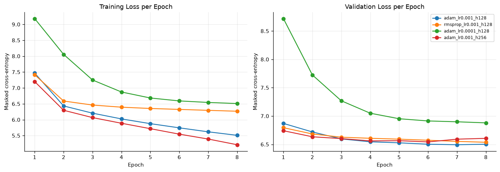
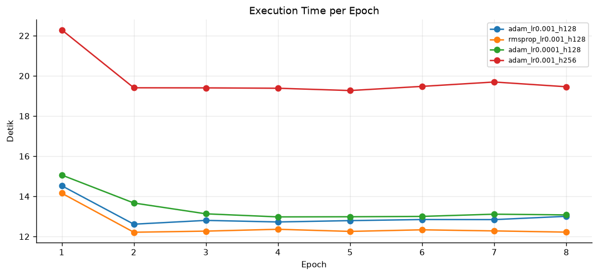
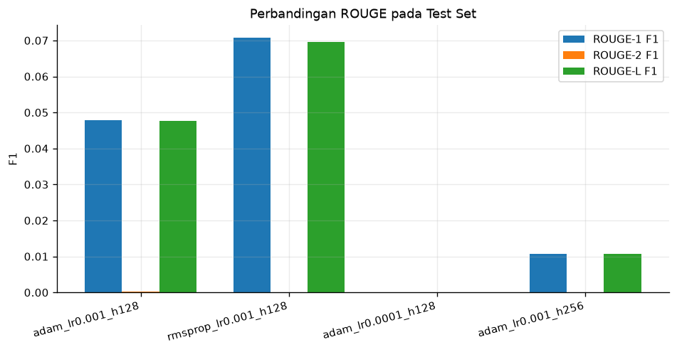

# Laporan Eksperimen Text Summarization dengan Seq2Seq Vanilla RNN

**Mata kuliah / tugas:** Text Summarization (Many-to-Many)  
**Framework:** TensorFlow 2.21 / Keras 3.15  
**Model:** Seq2Seq berbasis `SimpleRNN` murni (tanpa LSTM/GRU)  
**Tanggal eksperimen:** 8 November 2026

---

## 1. Deskripsi

### 1.1 Pendahuluan

Text summarization adalah tugas menghasilkan ringkasan pendek dari sebuah dokumen sumber dengan tetap mempertahankan informasi utama. Salah satu pendekatan klasik untuk tugas ini adalah **Sequence-to-Sequence (Seq2Seq)**, yaitu model encoder-decoder yang memetakan sequence input (artikel) menjadi sequence output (ringkasan).

Pada eksperimen ini digunakan arsitektur Seq2Seq **Many-to-Many** dengan sel **Vanilla RNN** murni. Setiap langkah decoder menghasilkan satu token, sehingga output berupa sequence ringkasan. Berbeda dengan LSTM/GRU, Vanilla RNN hanya memiliki satu hidden state sederhana:

$$h_t = \tanh(W_x x_t + W_h h_{t-1} + b)$$

Keterbatasan utama Vanilla RNN adalah vanishing gradient dan bottleneck pada satu vektor hidden state. Eksperimen ini bertujuan melihat perilaku tersebut secara empiris melalui perbandingan beberapa konfigurasi optimizer, learning rate, dan hidden dimension.

### 1.2 Tujuan

1. Mengimplementasikan pipeline lengkap text summarization berbasis Seq2Seq Vanilla RNN dengan TensorFlow/Keras.
2. Melakukan preprocessing teks Bahasa Indonesia, pembentukan vocabulary, encoding, dan padding.
3. Membandingkan minimal tiga konfigurasi eksperimen (optimizer, learning rate, dan hidden dimension).
4. Mencatat training loss, validation loss, dan execution time per epoch untuk setiap konfigurasi.
5. Melakukan inference autoregressive dengan fungsi `summarize(text)`.
6. Menghitung ROUGE-1, ROUGE-2, dan ROUGE-L pada data uji agar hasilnya siap dimasukkan ke tabel laporan.

### 1.3 Dataset

Dataset yang digunakan adalah `wikihow.json` dengan struktur:

```json
[
  {
    "pageName": "Agar-Akur-dengan-Pasangan",
    "steps": [
      {
        "abstract": "Fokuslah pada hal positif.",
        "article": "Penting untuk meluangkan waktu untuk menghargai pasangan ..."
      }
    ]
  }
]
```

Setiap `step` diposisikan sebagai satu pasangan data:

- **Input encoder:** `article` (penjelasan/langkah)
- **Target decoder:** `abstract` (ringkasan singkat)

Statistik dataset penuh:

| Item | Nilai |
|---|---:|
| Jumlah halaman | 25.630 |
| Jumlah pasangan `article`-`abstract` | 365.121 |
| Rata-rata token artikel | 36,8 |
| Median token artikel | 34 |
| Persentil ke-90 token artikel | 62 |
| Rata-rata token abstract | 5,4 |
| Median token abstract | 5 |
| Persentil ke-90 token abstract | 10 |

Karena keterbatasan komputasi (CPU-only), eksperimen utama menggunakan **6.011 pasangan** dari 512 halaman yang dipilih secara acak dengan seed 42. Kode mendukung seluruh dataset dengan mengubah `--max-samples 0`.

**Pembagian data (split per halaman agar tidak bocor):**

| Split | Jumlah pasangan |
|---|---:|
| Train | 4.793 |
| Validation | 600 |
| Test | 618 |
| **Total** | **6.011** |

Konfigurasi preprocessing:

- Pembersihan HTML entity/tag, URL, email, karakter non-umum, dan whitespace.
- Lowercase.
- Tokenisasi sederhana Bahasa Indonesia menggunakan regex kata Unicode `\w+`.
- Tidak dilakukan stemming/stopword removal agar informasi tetap utuh.
- Vocabulary dibangun **hanya dari train set**.
- Token khusus: `<PAD>` (0), `<UNK>` (1), `<SOS>` (2), `<EOS>` (3).
- Ukuran vocabulary aktual: **11.781 token**.
- Panjang maksimum artikel: **128 token**.
- Panjang maksimum sequence decoder: **26 token** (termasuk `<SOS>` dan `<EOS>`).
- Padding menggunakan `<PAD>`.
- Split dilakukan berdasarkan halaman, sehingga langkah-langkah dari halaman yang sama tidak muncul di train dan test sekaligus.

---

## 2. Eksperimen

### 2.1 Arsitektur Model

Implementasi terdapat pada `model.py`.

#### Encoder

```text
Input artikel (integer sequence)
        ↓
Embedding(vocab_size, embedding_dim, mask_zero=True)
        ↓
SimpleRNN(hidden_dim, activation="tanh", return_state=True)
        ↓
hidden state terakhir h_T
```

`mask_zero=True` penting agar RNN mengabaikan posisi `<PAD>`; tanpa masking, hidden state terakhir didominasi oleh padding dan informasi artikel hilang.

#### Decoder

```text
Input decoder (token sebelumnya)
        ↓
Embedding(vocab_size, embedding_dim)
        ↓
SimpleRNN(hidden_dim, return_sequences=True, initial_state=h_T)
        ↓
Dense(vocab_size) → logits
```

#### Seq2Seq

`Seq2Seq` menggabungkan Encoder dan Decoder. Saat training digunakan **teacher forcing**:

```text
summary_ids = [<SOS>, t1, t2, ..., <EOS>]
decoder_input  = [<SOS>, t1, t2, ..., t_{n-1}]
decoder_target = [t1, t2, ..., t_{n-1}, <EOS>]
```

Loss adalah cross-entropy per token yang mengabaikan posisi `<PAD>`. Saat inference, decoder berjalan **autoregressive** (greedy decoding): mulai dari `<SOS>`, prediksi token berikutnya, umpan balik token tersebut beserta hidden state, lalu berhenti saat `<EOS>` atau batas panjang tercapai.

### 2.2 Konfigurasi Eksperimen

Semua konfigurasi memakai embedding dimension 128, batch size 64, 8 epoch, dropout 0.2, gradient clipping 5.0, dan seed 42.

| Kode | Optimizer | Learning rate | Embedding | Hidden | Keterangan |
|---|---|---:|---:|---:|---|
| `adam_lr0.001_h128` | Adam | 0.001 | 128 | 128 | Baseline |
| `rmsprop_lr0.001_h128` | RMSprop | 0.001 | 128 | 128 | Perbandingan optimizer |
| `adam_lr0.0001_h128` | Adam | 0.0001 | 128 | 128 | Learning rate lebih kecil |
| `adam_lr0.001_h256` | Adam | 0.001 | 128 | 256 | Hidden dimension lebih besar |

Jumlah parameter:

- Konfigurasi hidden 128: **4.601.477 parameter**
- Konfigurasi hidden 256: **6.240.773 parameter**

### 2.3 Prosedur Training

- Loss: `MaskedSparseCategoricalCrossentropy(from_logits=True)`
- Optimizer: Adam / RMSprop, `clipnorm=5.0`
- Metrik: masked token accuracy
- Epoch: 8
- Batch size: 64
- Validation set dipakai untuk memilih bobot terbaik (`ModelCheckpoint` pada `val_loss`).
- Waktu eksekusi setiap epoch dicatat oleh callback `EpochTimer`.
- Inference evaluasi: greedy decoding, maksimum 25 langkah.
- Evaluasi test: 618 sampel.

### 2.4 Evaluasi ROUGE

Implementasi ROUGE berada di `rouge.py` dan tidak membutuhkan dependensi eksternal.

- **ROUGE-1:** overlap unigram dengan clipping.
- **ROUGE-2:** overlap bigram dengan clipping.
- **ROUGE-L:** Longest Common Subsequence (LCS).
- Skor yang dilaporkan adalah **rata-rata F1 per sampel** (macro average) pada 618 sampel uji.

### 2.5 Cara Menjalankan

```bash
pip install -r requirements.txt

# Eksperimen utama (4 konfigurasi)
python experiments.py --max-samples 6000 --epochs 8 --output-dir outputs --clean

# Seluruh dataset (lebih lama)
python experiments.py --max-samples 0 --epochs 10 --output-dir outputs_full

# Evaluasi dan tampilkan tabel
python evaluate.py --output-dir outputs

# Inference satu teks
python summarize.py --experiment outputs/best_model \
  --text "Fokuslah pada hal positif pasangan Anda dan luangkan waktu untuk menghargai hal-hal kecil."
```

Atau dari Python:

```python
from summarize import summarize

ringkasan = summarize(
    "Fokuslah pada hal positif pasangan Anda dan luangkan waktu untuk menghargai hal-hal kecil.",
    experiment_dir="outputs/best_model",
)
print(ringkasan)
```

---

## 3. Analisis

### 3.1 Training Loss dan Validation Loss

Tabel ringkasan hasil akhir:

| Konfigurasi | Train Loss | Val Loss | Best Val Loss | Training Time (s) | Avg Epoch Time (s) | ROUGE-1 | ROUGE-2 | ROUGE-L |
|---|---:|---:|---:|---:|---:|---:|---:|---:|
| `adam_lr0.001_h128` | 5,5090 | 6,5027 | **6,4938** | 104,92 | 13,02 | 0,0480 | 0,0003 | 0,0476 |
| `rmsprop_lr0.001_h128` | 6,2670 | 6,5372 | 6,5372 | **100,77** | **12,51** | **0,0707** | 0,0000 | **0,0696** |
| `adam_lr0.0001_h128` | 6,5090 | 6,8797 | 6,8797 | 107,86 | 13,38 | 0,0000 | 0,0000 | 0,0000 |
| `adam_lr0.001_h256` | **5,2133** | 6,6066 | 6,5435 | 158,98 | 19,80 | 0,0108 | 0,0000 | 0,0108 |

> Waktu pada kolom **Training Time** adalah durasi `model.fit` (training + validasi) dan tidak termasuk evaluasi ROUGE pada test set.

Grafik training dan validation loss:



**Observasi:**

1. **Adam lr 0.001, hidden 128** memberikan validation loss terendah (6,4938) dan penurunan training loss yang stabil.
2. **Adam lr 0.001, hidden 256** memiliki training loss paling rendah (5,2133), tetapi validation loss lebih tinggi (6,6066) dan mulai meningkat setelah epoch 6. Ini indikasi **overfitting**.
3. **Adam lr 0.0001** masih berada pada fase underfitting: validation loss 6,8797 dan masih menurun perlahan. Model ini bahkan gagal menghasilkan token (langsung memprediksi `<EOS>`), sehingga ROUGE = 0.
4. **RMSprop lr 0.001** memiliki training loss lebih tinggi daripada Adam, tetapi validation loss kompetitif (6,5372) dan menghasilkan ROUGE-L tertinggi.
5. Semua kurva validation loss mendatar di sekitar 6,5. Model belum mampu mempelajari pemetaan artikel→ringkasan secara spesifik.

### 3.2 Execution Time per Epoch

| Konfigurasi | Rata-rata per epoch (s) | Total 8 epoch (s) | Rasio terhadap baseline |
|---|---:|---:|---:|
| `rmsprop_lr0.001_h128` | 12,51 | 100,77 | 0,96× |
| `adam_lr0.001_h128` | 13,02 | 104,92 | 1,00× |
| `adam_lr0.0001_h128` | 13,38 | 107,86 | 1,03× |
| `adam_lr0.001_h256` | 19,80 | 158,98 | **1,52×** |

Grafik waktu eksekusi per epoch:



**Observasi:**

- Hidden dimension 256 meningkatkan waktu per epoch sekitar **52%** dibanding hidden 128, tetapi tidak meningkatkan ROUGE secara konsisten.
- RMSprop sedikit lebih cepat daripada Adam pada konfigurasi yang sama.
- Waktu per epoch relatif stabil setelah epoch pertama (epoch pertama lebih lambat karena proses build/kompilasi).
- Tabel lengkap per epoch tersedia di `outputs/per_epoch_epoch_time_sec.csv` dan `outputs/per_epoch_epoch_time_sec.md`.

### 3.3 Hasil ROUGE pada Test Set

| Konfigurasi | ROUGE-1 F1 | ROUGE-2 F1 | ROUGE-L F1 |
|---|---:|---:|---:|
| `adam_lr0.001_h128` | 0,0480 | 0,0003 | 0,0476 |
| `rmsprop_lr0.001_h128` | **0,0707** | 0,0000 | **0,0696** |
| `adam_lr0.0001_h128` | 0,0000 | 0,0000 | 0,0000 |
| `adam_lr0.001_h256` | 0,0108 | 0,0000 | 0,0108 |

Grafik perbandingan ROUGE:



**Contoh prediksi pada test set:**

| Referensi | Prediksi `adam_lr0.001_h128` | Prediksi `rmsprop_lr0.001_h128` | Prediksi `adam_lr0.001_h256` |
|---|---|---|---|
| hitunglah laju metabolisme basal lmb anda | gunakan bahwa anda | gunakan dengan yang | gunakan tanda koma |
| gunakan kalkulator lmb daring | gunakan bahwa anda | gunakan dengan yang | gunakan tanda koma |
| mulailah menulis jurnal makanan | gunakan bahwa anda | gunakan dengan yang | gunakan tanda koma |

**Temuan penting:**

- Setiap model menghasilkan **satu prediksi yang sama untuk seluruh 618 sampel uji** (unique prediction = 1). Ini menunjukkan **mode collapse**: decoder berperilaku seperti language model umum, bukan model kondisional terhadap artikel.
- `adam_lr0.0001_h128` menghasilkan **618 prediksi kosong** karena selalu memprediksi `<EOS>` pada langkah pertama.
- ROUGE-2 hampir nol karena frasa generik yang dihasilkan tidak memiliki bigram yang sama dengan referensi.
- RMSprop menang ROUGE-L bukan karena ringkasannya lebih baik secara semantik, tetapi karena frasa `"gunakan dengan yang"` kebetulan memiliki lebih banyak unigram umum yang juga muncul di referensi.

### 3.4 Diskusi

Hasil ini memperlihatkan karakteristik Vanilla RNN Seq2Seq pada tugas summarization:

1. **Bottleneck satu vektor hidden state.** Seluruh artikel (hingga 128 token) harus diringkas menjadi satu vektor. Untuk artikel yang panjang, informasi awal cepat hilang.
2. **Vanishing gradient.** RNN sederhana sulit mempertahankan informasi jangka panjang, sehingga decoder cenderung mengandalkan token terakhir dan frekuensi token pada data latih.
3. **Frequency bias pada cross-entropy.** Token/frasa umum seperti “gunakan” mendominasi loss. Model menemukan solusi lokal berupa frasa generik yang aman secara loss, tetapi tidak informatif.
4. **Exposure bias.** Saat training decoder selalu menerima token ground-truth (teacher forcing), sedangkan saat inference menerima prediksinya sendiri. Kesalahan kecil di awal dapat membuat decoder keluar dari distribusi training.
5. **Data dan durasi terbatas.** Eksperimen hanya memakai 6.011 pasangan dan 8 epoch pada CPU. Dataset penuh (365.121 pasangan) dan epoch lebih banyak berpotensi memperbaiki hasil, tetapi tetap dibatasi oleh kapasitas Vanilla RNN.
6. **Validation loss tidak selalu sejalan dengan ROUGE.** Adam hidden 128 memiliki validation loss terbaik, tetapi ROUGE-L lebih rendah daripada RMSprop. Hal ini menunjukkan bahwa loss token-level tidak identik dengan kualitas ringkasan.

Secara implementasi, pipeline sudah berjalan benar: training loss menurun, validation loss terpantau, inference autoregressive menghasilkan sequence, dan ROUGE dapat dihitung. Namun, kualitas ringkasan yang dihasilkan masih jauh dari memadai untuk penggunaan nyata.

### 3.5 Keterbatasan

- Hanya menggunakan 6.011 dari 365.121 pasangan data.
- Belum menggunakan attention mechanism.
- Belum menggunakan beam search, scheduled sampling, atau coverage mechanism.
- Tokenisasi masih sederhana; belum ada stemming/lemmatization Bahasa Indonesia.
- Evaluasi ROUGE berbasis overlap kata, belum menangkap kualitas semantik.
- Model dijalankan di CPU, sehingga eksplorasi hyperparameter dan epoch terbatas.

---

## 4. Kesimpulan

1. Implementasi Seq2Seq Vanilla RNN dengan TensorFlow/Keras berhasil dibuat secara modular, meliputi preprocessing, Vocabulary, Encoder, Decoder, Seq2Seq, training, inference, evaluasi ROUGE, dan pembuatan laporan otomatis.
2. Empat konfigurasi eksperimen berhasil dibandingkan:
   - Adam lr 0.001, hidden 128
   - RMSprop lr 0.001, hidden 128
   - Adam lr 0.0001, hidden 128
   - Adam lr 0.001, hidden 256
3. Berdasarkan **ROUGE-L**, konfigurasi terbaik adalah **RMSprop lr 0.001, hidden 128** dengan ROUGE-1 = 0,0707 dan ROUGE-L = 0,0696.
4. Berdasarkan **validation loss**, konfigurasi terbaik adalah **Adam lr 0.001, hidden 128** dengan best validation loss = 6,4938.
5. Hidden dimension 256 meningkatkan waktu training sekitar 1,52× dan jumlah parameter, tetapi tidak meningkatkan ROUGE secara konsisten.
6. Learning rate 0.0001 terlalu kecil untuk 8 epoch; model underfit dan menghasilkan ringkasan kosong.
7. Kualitas ringkasan masih rendah. Penyebab utamanya adalah keterbatasan Vanilla RNN (bottleneck satu hidden state dan vanishing gradient), mode collapse ke frasa umum, serta data/epoch yang terbatas.
8. Untuk pengembangan selanjutnya disarankan:
   - Menambah jumlah data dan epoch.
   - Menambahkan attention mechanism.
   - Menggunakan beam search dan scheduled sampling.
   - Mencoba subword tokenization.
   - Sebagai pembanding di luar batasan tugas, menggunakan LSTM/GRU atau Transformer.

---

## Lampiran A — Tabel Per-Epoch

### A.1 Training Loss

| Epoch | adam_lr0.0001_h128 | adam_lr0.001_h128 | adam_lr0.001_h256 | rmsprop_lr0.001_h128 |
|---:|---:|---:|---:|---:|
| 1 | 9,1814 | 7,4665 | 7,2001 | 7,4139 |
| 2 | 8,0558 | 6,4335 | 6,2971 | 6,5886 |
| 3 | 7,2498 | 6,2066 | 6,0671 | 6,4620 |
| 4 | 6,8725 | 6,0255 | 5,8891 | 6,3946 |
| 5 | 6,6835 | 5,8762 | 5,7181 | 6,3540 |
| 6 | 6,5919 | 5,7448 | 5,5462 | 6,3249 |
| 7 | 6,5437 | 5,6194 | 5,3923 | 6,2952 |
| 8 | 6,5090 | 5,5090 | 5,2133 | 6,2670 |

### A.2 Validation Loss

| Epoch | adam_lr0.0001_h128 | adam_lr0.001_h128 | adam_lr0.001_h256 | rmsprop_lr0.001_h128 |
|---:|---:|---:|---:|---:|
| 1 | 8,7193 | 6,8699 | 6,7410 | 6,7945 |
| 2 | 7,7253 | 6,7193 | 6,6343 | 6,6837 |
| 3 | 7,2694 | 6,5965 | 6,6019 | 6,6269 |
| 4 | 7,0502 | 6,5455 | 6,5617 | 6,6073 |
| 5 | 6,9524 | 6,5275 | 6,5650 | 6,5921 |
| 6 | 6,9136 | 6,5029 | 6,5435 | 6,5729 |
| 7 | 6,8987 | 6,4938 | 6,5920 | 6,5530 |
| 8 | 6,8797 | 6,5027 | 6,6066 | 6,5372 |

### A.3 Execution Time per Epoch (detik)

| Epoch | adam_lr0.0001_h128 | adam_lr0.001_h128 | adam_lr0.001_h256 | rmsprop_lr0.001_h128 |
|---:|---:|---:|---:|---:|
| 1 | 15,0658 | 14,5327 | 22,2934 | 14,1621 |
| 2 | 13,6733 | 12,6179 | 19,4097 | 12,2169 |
| 3 | 13,1342 | 12,8066 | 19,4048 | 12,2724 |
| 4 | 12,9807 | 12,7285 | 19,3870 | 12,3645 |
| 5 | 12,9873 | 12,7952 | 19,2721 | 12,2586 |
| 6 | 13,0056 | 12,8494 | 19,4796 | 12,3383 |
| 7 | 13,1164 | 12,8461 | 19,6971 | 12,2830 |
| 8 | 13,0802 | 13,0099 | 19,4600 | 12,2227 |

---

## Lampiran B — Struktur Kode

| File | Fungsi |
|---|---|
| `config.py` | Konfigurasi data, hyperparameter, dan daftar eksperimen |
| `preprocessing.py` | Pembersihan teks, tokenisasi, Vocabulary, padding |
| `data.py` | Pembacaan `wikihow.json`, split per halaman, encoding ke tensor |
| `model.py` | Encoder, Decoder, Seq2Seq, masked loss, optimizer |
| `rouge.py` | Implementasi ROUGE-1, ROUGE-2, ROUGE-L |
| `training.py` | Training, timer per epoch, evaluasi, tabel, grafik |
| `experiments.py` | CLI menjalankan seluruh konfigurasi |
| `inference.py` | Greedy autoregressive decoding |
| `summarize.py` | Fungsi `summarize(text)` dan CLI inference |
| `evaluate.py` | Menampilkan tabel evaluasi dari `result.json` |
| `report.md` | Laporan ini |
| `requirements.txt` | Dependensi Python |

Artefak hasil eksperimen:

```text
outputs/
├── best_model/                  # model terbaik + vocab + konfigurasi
├── experiments/
│   ├── adam_lr0.001_h128/
│   ├── rmsprop_lr0.001_h128/
│   ├── adam_lr0.0001_h128/
│   └── adam_lr0.001_h256/
├── comparison.csv
├── comparison.md
├── evaluation_table.csv
├── loss_curves.png
├── epoch_times.png
├── rouge_comparison.png
├── per_epoch_train_loss.md
├── per_epoch_val_loss.md
└── per_epoch_epoch_time_sec.md
```

Setiap direktori konfigurasi berisi:

- `model.weights.h5`
- `vocab.json`
- `model_config.json`
- `history.csv`
- `test_predictions.csv`
- `result.json`

---

## Lampiran C — Lingkungan Eksperimen

| Item | Nilai |
|---|---|
| OS | Windows |
| Python | 3.13.1 |
| TensorFlow | 2.21.0 |
| Keras | 3.15.1 |
| GPU | Tidak tersedia (CPU-only) |
| Seed | 42 |
